GNSS Vector Direction Analysis (GVDA): A QGIS Plugin for Circular Statistical Analysis of GNSS Time Series from CORS

# What is this repository for?

The GNSS Vector Direction Analysis (GVDA) plugin is an open-source QGIS extension for visualising and analysing position time series from GNSS continuously operating reference stations (CORS).

This plugin presents a computational approach for analysing GNSS horizontal displacement directions using circular statistics, horizontal displacement is represented as a vector defined by its magnitude and azimuth. The GVDA plugin was developed in Python and integrated into QGIS as an open-access tool for loading, visualising, and analysing time series from multiple data services. It supports the PBO and NEU formats and converts displacement data to polar coordinates to compute circular metrics. Circular statistics provide a complementary statistical framework for the analysis of GNSS CORS station time series by enabling the interpretation of horizontal displacements as vectorial processes. GVDA supports single-station analysis and allows users to select multiple GNSS stations from an online data service to compare their displacement trends.

A key feature of GVDA is the integration of absolute and relative displacement analyses within a common directional statistical framework. The absolute displacement method highlights persistent displacement orientations and long-term directional trends, making it particularly suitable for assessing the directional consistency of accumulated horizontal displacements. In contrast, the relative displacement method captures short-term directional variability between consecutive epochs, allowing for the identification of oscillatory behaviour, transient displacements, and potential anomalies, outliers, and offsets.

This guide describes the complete workflow, from loading time-series data to generating charts and exporting final outputs.

# Plugin installation

GVDA is currently available for installation from GitHub, with a second installation method planned through the official QGIS Plugin Repository. Submission to the official QGIS Plugin Repository is planned if the associated scientific article is accepted for publication.

## Installation options

### Option 1. Installation from GitHub (ZIP file)

Download the GVDA plugin ZIP file from the GitHub repository.

Open QGIS Desktop (version 3.30 or later, within the declared compatibility range of 3.30–3.44).

In QGIS, select Plugins → Manage and Install Plugins…

*Figure 1. Manage and Install Plugins menu.*

Select Install from ZIP.

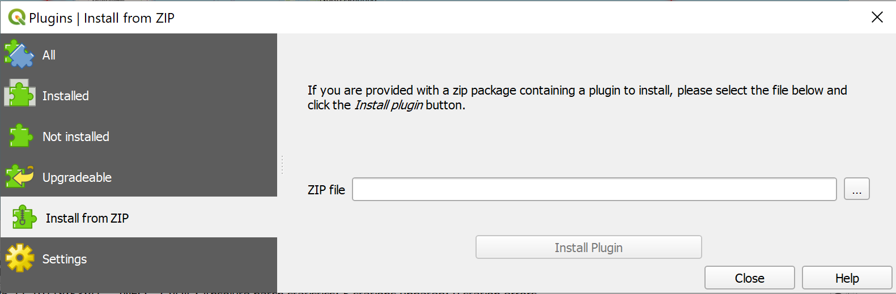

*Figure 2. Installation from a ZIP file.*

Select the ZIP file and click **Install Plugin.**

If a security warning appears, confirm the installation only if you trust the source.

*Figure 3. Security warning.*

Verify that GVDA is installed and enabled.

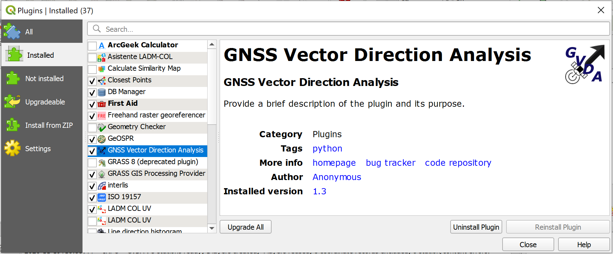

*Figure 4. GVDA plugin verification.*

For information on software compatibility, Python dependencies, and the tested environment, refer to the “Software requirements and dependencies” section.

You can check out the step-by-step installation example in the following YouTube resource https://www.youtube.com/watch?v=AUQouvFyt34

### Option 2. Installation from the official QGIS Plugin Repository

Once GVDA becomes available in the official QGIS Plugin Repository, it can be installed directly from QGIS.

Open QGIS and select **Plugins → Manage and Install Plugins….**

Select the **All** tab and enter GVDA in the search field.

Select **GNSS Vector Direction Analysis (GVDA)** and click **Install Plugin.**

Verify that the plugin is installed and enabled.

## Test Data

The shared files contain GNSS station position time series used in the research and for testing the GVDA plugin. These datasets originate from external GNSS data services and remain subject to the applicable terms of use and licensing conditions of their respective providers.

The test data are available in the *“Timeserie”* folder of this repository. These example datasets allow users to test the data-loading, validation, and analysis procedures. Users may also analyse their own GNSS time series or retrieve station data from the online services supported by GVDA.

# Usage

## Main GVDA Interface

The main GVDA panel is divided into several sections (Figure 5):

- **Start**: Load GNSS time series from local files or retrieve station data from supported online services and configure input parameters.

- **Validation**: Verify the input data and select the fields required for analysis.

- **Results**: Display the results of the directional statistical analysis and the corresponding charts.

- **Data**: View the processed data in tabular format.

- **Settings**: Configure graphical outputs and report options.

*Figure 5. General layout of the GVDA plugin interface.*

## Start panel

### Loading the Time Series and Input Parameters

Select a local time-series file in PBO, NEU or TXT format using the file browser (Figure 6).

Next, identify the row where the data section begins, after any descriptive metadata or header information (for example, “End Field Description” or a separator line). If the time series contains column headings, select the “Data with headers” checkbox.

Select “Verify” to preview the imported data. Adjust the import settings as necessary until the data are displayed correctly.

The plugin can display a basemap from providers such as OpenStreetMap, Google Maps, Bing Satellite, ESRI, etc.

Indicate whether the input file contains station coordinates:

- Select “**Yes**” if the input file contains latitude and longitude coordinates, then select the corresponding fields.

- Select “**No**” if the coordinates are not included. The station can then be selected from a preloaded station list (CDDIS solution for GPS week 2237, day 6).

*Figure 6. Loading a local time series and configuring input parameters.*

#### Control Buttons

- **…**: Browse for a time-series file to load.

- **Verify**: Check the imported file structure and the separation of metadata and data.

- **Yes / No**: Indicate whether station coordinates are included in the file.

- **Upload Data**: Display the records in the QGIS interface.

- **Next**: Proceed to the next stage.

### Searching for Time Series

The time-series search panel contains (Figure 7):

- A selector for the available GNSS data services (NGL, JPL and EPOS) and the Compressed file option.

- A description of the selected service.

- A list of available CORS stations from the selected data service.

- A list of selected stations.

- Clear Selection and Next buttons.

*Figure 7. Time-series search panel in GVDA.*

#### Input Parameters

Select one or more stations from the service catalogue. Multiple stations can be selected for subsequent batch analysis.

Stations can be removed individually, or the entire selection can be cleared.

#### Control buttons

- **Clear Selection**: Remove all selected stations.

- **Next**: Continue to the validation stage.

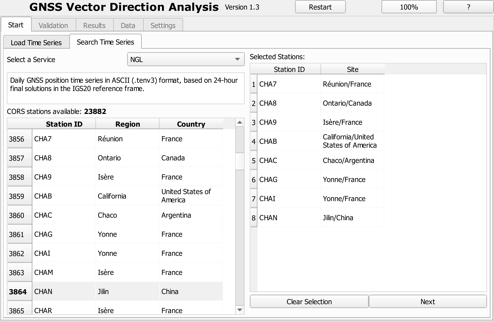

*Figure 8. Selection of multiple GNSS stations for analysis.*

## Validation

Regardless of whether the data are loaded as an individual GNSS time series or as a set of stations retrieved from an online data service, the next step is the **Validation** panel.

### Selecting the time field (epoch)

Select the field containing the epoch information, such as a calendar date (**YYYYMMDD**), a Modified Julian Date field (**JJJJJ.JJJJJ**) or a decimal year (**YYYY.YYYYYY**). Select the appropriate format when prompted (Figure 9).

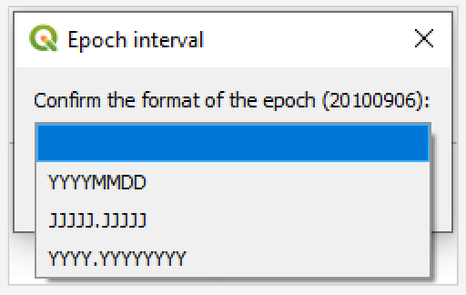

*Figure 9. Epoch-format selection.*

The dates are converted internally into a standardised Modified Julian Date representation for subsequent processing.

### Selecting the North component difference

Select the field containing the North displacement component in the NEU reference system.

### Selecting the East component difference

Select the field containing the East displacement component in the NEU reference system.

GVDA displays the original North and East components and their values expressed relative to the initial epoch, together with graphical representations of both components over time (Figure 10).

*Figure 10. Validation screen showing the selected fields and displacement components.*

#### Control Buttons

- **Analyse Station**: Process the selected station.

- **Batch Analysis**: Analyse the selected stations together. This option is only available when station data are retrieved through the Search Time Series panel.

# Results

Once displacement vectors are obtained, circular statistical descriptors are computed to evaluate the directional characteristics of the GNSS time series.

## Results from Loading Time Series

Two methods are available to analyse horizontal displacements derived from GNSS position time series.

### Absolute Method

Each position is compared with the position at the initial epoch or a selected reference epoch. This method highlights long-term directional trends and persistent patterns of horizontal displacement (Figure 11). Definitions of the statistical parameters presented below are provided in a report that can be generated from the Settings panel.

- **Statistical Results for the Absolute Method**

#### CIRCULAR STATISTICS (AZIMUTHS)

##### Central Tendency

- Mean Azimuth

- Mode Azimuth

- Median Azimuth

##### Dispersion

- Discrepancy

- Length of Mean Vector

- Circular Variance

- Circular Standard Deviation

- Angular Variance

- Mean Angular Deviation

- Angular Standard Deviation

- Circular Dispersion

- Von Mises Concentration Parameter

##### Shape

- Kurtosis coefficient

- Skewness coefficient

##### Epoch Interval

- Initial epoch: Date of the first record.

- Final epoch: Date of the last record.

- Epoch interval: Time interval between consecutive observations.

- Number of interruptions: Number of gaps or discontinuities identified in the time series.

*Figure 11. Absolute method results for the Reykjavik station.*

### Relative Method

Each position is compared with the position at the immediately preceding epoch. This strategy emphasises short-term directional variability and facilitates the detection of anomalies, outliers and offsets (Figure 12). When consecutive observations are separated by more than one day, the displacement magnitude is normalised by the elapsed time to obtain a daily displacement rate for anomaly detection.

The same circular statistical parameters used in the absolute method are calculated here, but they describe the directions of horizontal displacements between consecutive epochs.

- **Statistical Results for the Relative Method**

#### CIRCULAR STATISTICS (AZIMUTHS)

##### Central Tendency

- Mean Azimuth

- Mode Azimuth

- Median Azimuth

##### Dispersion

- Discrepancy

- Length of Mean Vector

- Circular Variance

- Circular Standard Deviation

- Angular Variance

- Mean Angular Deviation

- Angular Standard Deviation

- Circular Dispersion

- Von Mises Concentration Parameter

##### Shape

- Kurtosis coefficient

- Skewness coefficient

##### Anomalies

- Detection of anomalies, outliers, and offsets.

- Analysis based on the methodology defined by the NATO Standardisation Agreement (STANAG).

### Outputs include:

Confidence multiplier (M). This value is calculated according to the STANAG methodology for samples with fewer than 167 observations. For larger samples, M = 3.5.

Horizontal Standard Deviation. A measure of the variability of horizontal displacement residuals, considering both the East (E) and North (N) components.

Threshold criteria. A residual is flagged as a potential anomaly when its absolute value exceeds the threshold defined by the horizontal standard deviation multiplied by the confidence multiplier (M).

Total anomalies. The number of horizontal displacement variations that exceed the specified detection threshold.

*Figure 12. Relative method results for the Reykjavik station.*

##### List

The anomaly list displays observations flagged during the directional analysis. These observations are identified for review and are not automatically removed or corrected (Figure 13). It is possible to generate an analysis report in HTML format.

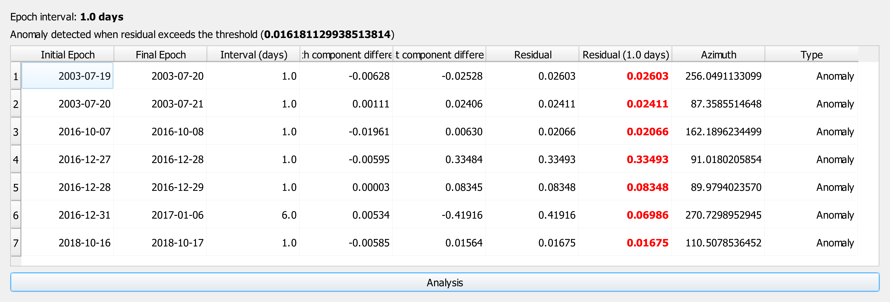

*Figure 13. Anomalies list for the Reykjavik station.*

#### Visualisation of anomalies

The anomalies visualisation is performed as shown in the QGIS canvas (Figure 14):

**Blue arrows**: Displacement vectors that satisfy the specified threshold criterion.

**Red arrows**: Displacement vectors flagged as anomalies.

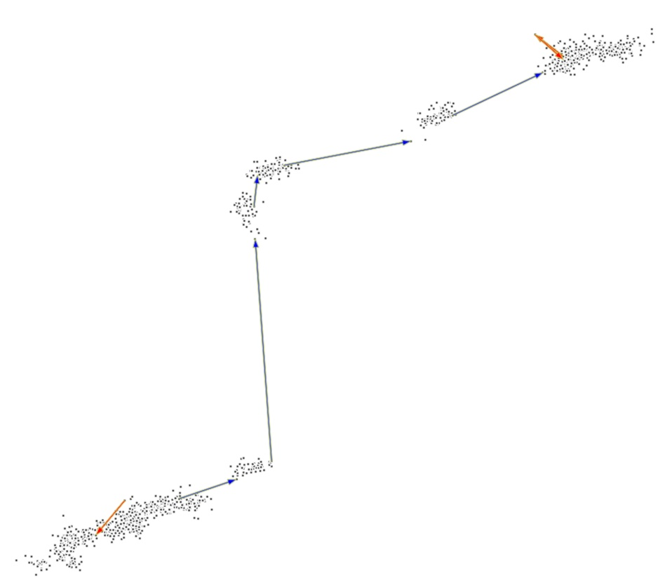

*Figure 14. Anomalies visualisation.*

### Graphical Results

The following graphical results are available for both the absolute and relative methods. The figures show the results for the absolute method.

#### Circular Graphics

##### Unit Circle Plots

The unit circle plot represents the distribution of displacement azimuths on a unit circle (Figure 15). The epoch-based version incorporates temporal information, allowing users to examine changes in displacement direction over time (Figure 16).

| 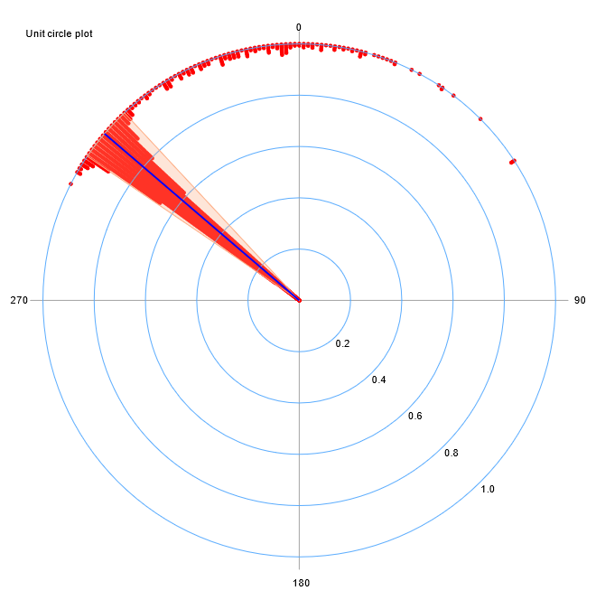 | 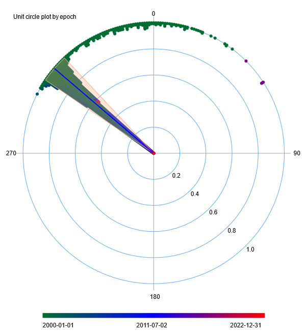 |
| --- | --- |
| *Figure 15. Unit circle plot.* | *Figure 16. Unit circle plot by epoch.* |

##### Azimuth with Radial Epoch Encoding

This plot represents displacement azimuths using angular coordinates, while the radial position encodes the observation epoch (Figure 17). It facilitates the examination of directional changes throughout the time series.

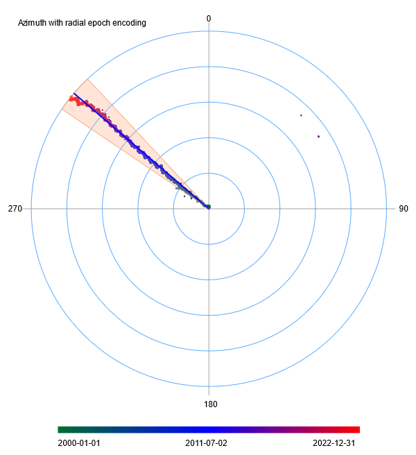

*Figure 17. Azimuth with radial epoch encoding.*

##### Azimuth–Distance Polar Plots

The azimuth–distance polar plot represents horizontal displacement vectors using azimuth as the angular coordinate and displacement magnitude as the radial coordinate (Figure 18).

The epoch-based version additionally incorporates temporal information, allowing users to examine the evolution of displacement magnitude and direction throughout the observation period (Figure 19).

| 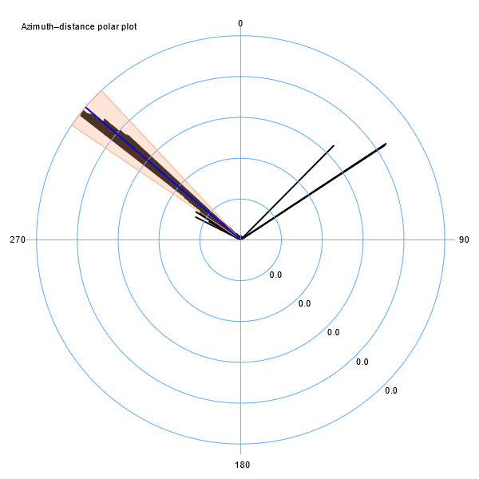 | 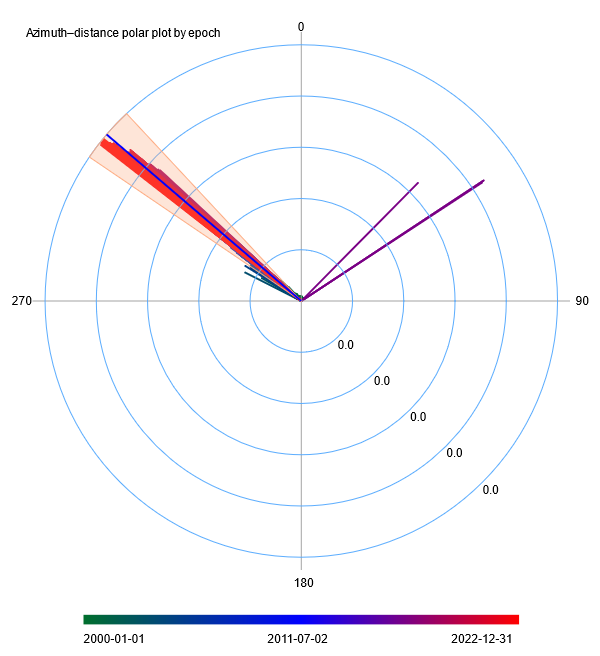 |
| --- | --- |
| *Figure 18. Azimuth–Distance Polar Plot.* | *Figure 19. Azimuth–Distance Polar Plot by Epoch.* |

##### Annual Azimuth–Distance Polar Plot

This plot summarises the annual net horizontal displacement vectors, showing their azimuths and magnitudes (Figure 20). The thickness of each representation indicates the magnitude of the annual net horizontal displacement.

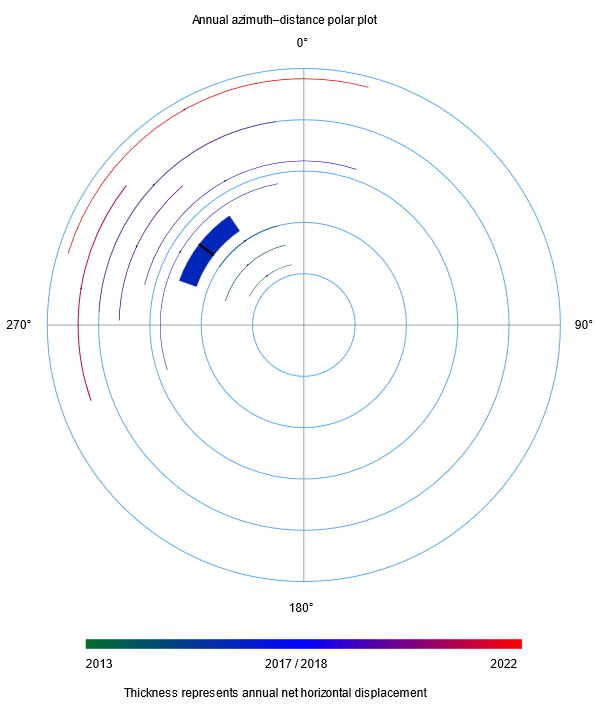

*Figure 20. Annual Azimuth–Distance Polar Plot.*

##### Circular KDE Plot by Epoch

This plot represents the estimated circular density of displacement azimuths, incorporating temporal information (Figure 21). It facilitates the identification of predominant displacement directions and changes in directional concentration over time.

##### Skewness and Kurtosis Plot

This plot displays circular skewness and kurtosis statistics for the displacement azimuths (Figure 22), providing complementary information about the shape of their directional distribution.

| 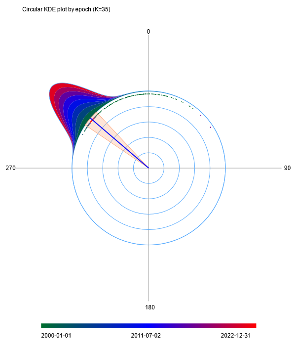 | 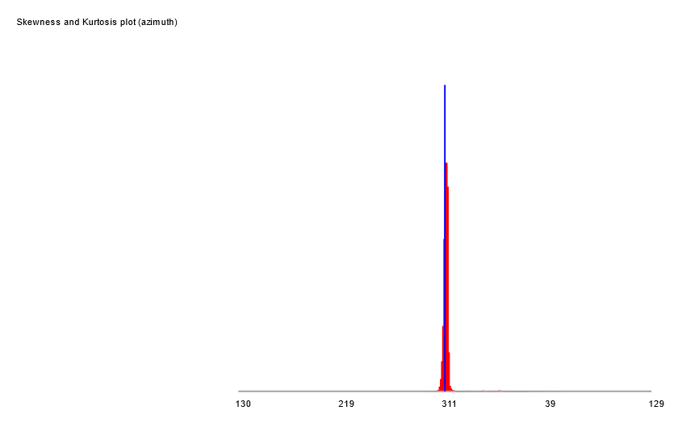 |
| --- | --- |
| *Figure 21. Circular KDE Plot by Epoch.* | *Figure 22. Skewness and kurtosis plot.* |

##### Uniform Q–Q Plot (Azimuth)

This plot compares the observed azimuth distribution with a theoretical uniform circular distribution (Figure 23). Deviations from the reference pattern may indicate departures from directional uniformity.

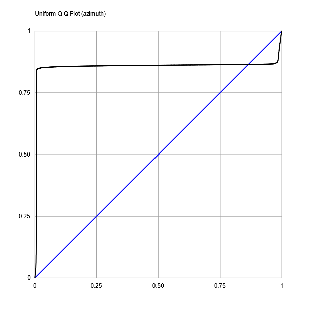

*Figure 23. Uniform Q–Q Plot (Azimuth)*

#### Linear Graphics

##### Module histogram

This histogram shows the frequency distribution of horizontal displacement magnitudes (Figure 24), allowing users to examine their variability and identify unusually large displacement values.

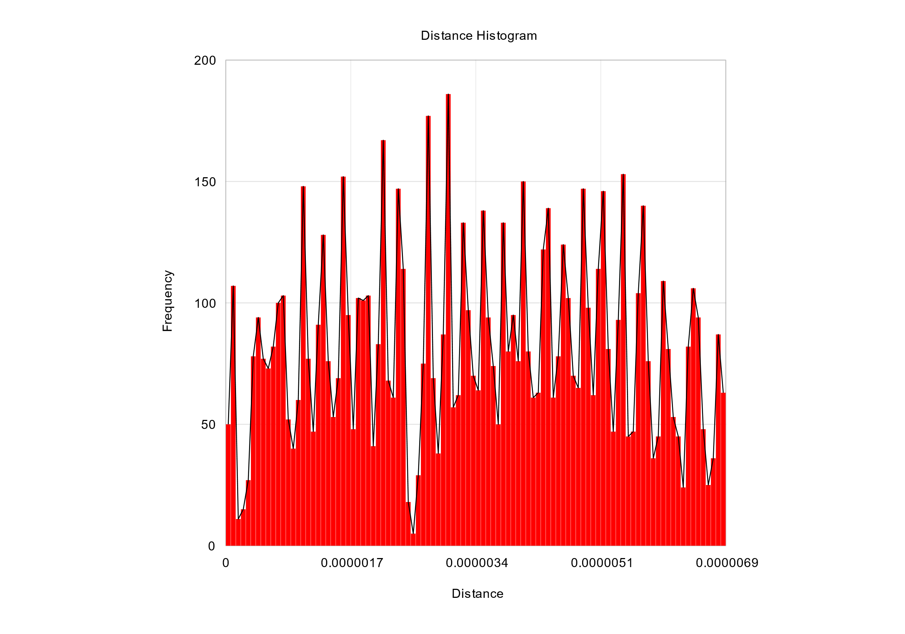

*Figure 24. Module Histogram*

##### Temporal Evolution of Azimuth and Distance

This plot shows the evolution of displacement azimuth and magnitude over time (Figure 25), allowing users to examine temporal variations in both directional and linear displacement characteristics.

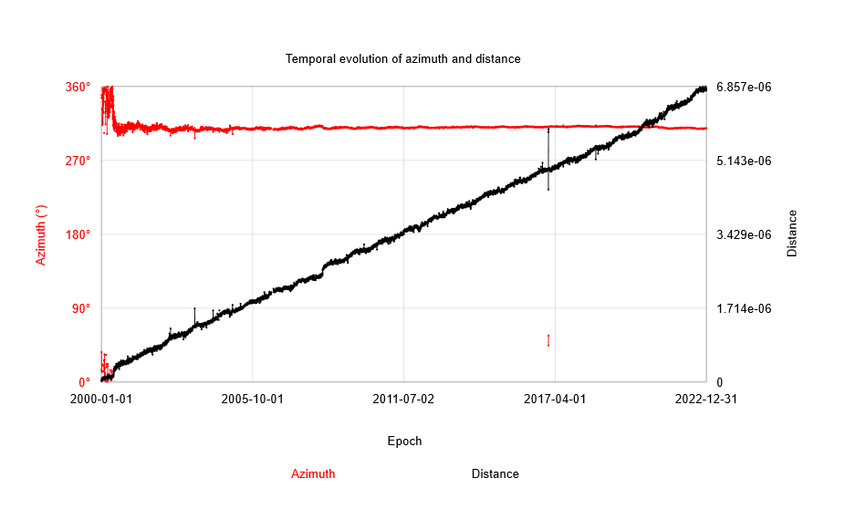

*Figure 25. Temporal Evolution of Azimuth and Distance.*

### Export Options

This panel offers two export options:

- **Clipboard**: Copy the graph to the clipboard.

- **Save as SVG**: Export the graph in Scalable Vector Graphics (SVG) format.

## Results from Searching for Time Series

### Single-Station Analysis

The results obtained from analysing a single station retrieved from an online data service include the same statistical parameters and graphical outputs as those generated when loading a local time-series file, as described in Section 4.1.

### Batch analysis

Batch Analysis allows multiple GNSS stations selected from an online data service to be analysed together. The results are presented in a comparative table (Figure 26), showing the observation epochs and the mean azimuth and circular standard deviation for the selected stations.

The mean azimuth provides a measure of central tendency, while the circular standard deviation describes the dispersion of displacement directions.

*Figure 26. Batch analysis results for multiple GNSS stations.*

By clicking **View**, the locations of the analysed GNSS stations are displayed on the QGIS map canvas (Figure 27). The corresponding analysis results are available in the layer's attribute table (Figure 28).

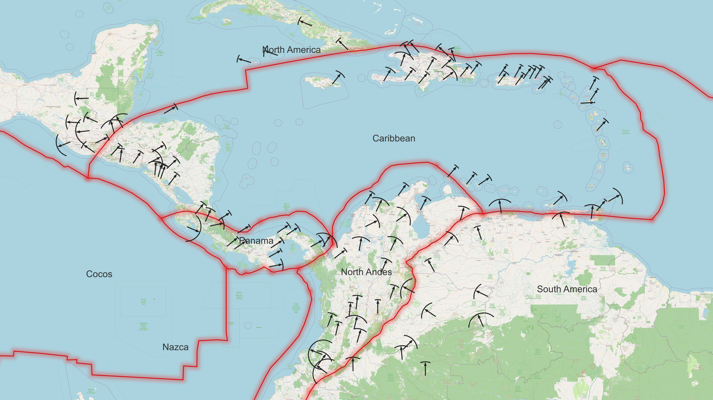

*Figure 27. Spatial representation of the analysed GNSS stations in QGIS. Analysis of 110 GNSS stations in South and Central America. Stations were randomly selected from different regions within each country of interest. Arrow directions represent the mean azimuth, and the arcs represent the circular standard deviation. Basemap: OpenStreetMap; tectonic plate boundaries: USGS.*

*Figure 28.  Results available in the layer's attribute table.*

# Data

The Data tab displays all the processed records (Figure 29), including:

- Time (epoch)

- North component difference

- East component difference

- Distance

- Azimuth

In the Absolute mode, Distance and Azimuth are calculated for each epoch relative to the initial epoch or a selected reference epoch.

In the Relative mode, Distance and Azimuth are calculated for each epoch relative to the preceding epoch.

The processed data can be exported in CSV format by clicking the “**…**” button.

*Figure 29. Data menu interface.*

# Settings

## Graphic Settings

The following graphical parameters can be configured:

- **Number of rings and sectors**: Configure the radial and angular divisions of circular plots.

- **Kappa and time bands**: Configure the smoothing parameter and temporal grouping used in the circular KDE plot by epoch.

- **Opacity**: Adjust the transparency of graphical elements.

- **Colours**: Customise the colours of rings, sectors, points, lines, mean direction, deviation and density map.

## Report Settings

The report options include (Figure 30):

- The report date.

- Project description.

- Graphics copied from the clipboard.

- Data tables.

- The report can be generated in HTML format.

*Figure 30. Graphic and report settings in GVDA.*

# Computational performance

The batch-processing performance of the GNSS Vector Direction Analysis (GVDA) QGIS plugin was evaluated on a desktop computer equipped with an Intel Core i5-2400 CPU operating at 3.10 GHz and 16 GB of RAM. The evaluation used GNSS station time series from three data sources (EPOS, NGL, and JPL) and eight batch sizes ranging from 2 to 100 stations. Processing time is reported in decimal minutes.

Processing time increased with batch size for all three data sources. For batches of 20 stations, elapsed times ranged from 0.29 to 0.45 min; at 60 stations, they ranged from 1.17 to 2.44 min. At the largest tested batch size of 100 stations, the elapsed times were 4.82 min for EPOS, 4.76 min for NGL, and 4.94 min for JPL, yielding an arithmetic mean of 4.84 min across the three sources. Thus, under the tested conditions, GVDA processed 100 stations in less than 5 min for each data source.

*Table  1. Elapsed batch-processing time (min) by data source and number of GNSS stations.*

| Stations | EPOS | NGL | JPL | Mean |
| --- | --- | --- | --- | --- |
| 2 | 0.03 | 0.03 | 0.04 | 0.03 |
| 5 | 0.07 | 0.08 | 0.11 | 0.09 |
| 10 | 0.14 | 0.16 | 0.20 | 0.17 |
| 20 | 0.45 | 0.29 | 0.44 | 0.39 |
| 40 | 0.71 | 0.53 | 1.12 | 0.79 |
| 60 | 2.29 | 1.17 | 2.44 | 1.97 |
| 80 | 3.30 | 3.06 | 3.27 | 3.21 |
| 100 | 4.82 | 4.76 | 4.94 | 4.84 |

The relative ordering of the data sources varied with batch size. For example, NGL had the shortest recorded time at 60 stations, whereas the three measurements differed by only 0.18 min (approximately 11 s) at 100 stations. These differences should be interpreted as descriptive results for the tested batches rather than as intrinsic performance differences between providers. Station count alone does not characterise the computational workload: batches with the same number of stations may contain different numbers of GNSS observations (Figure 31).

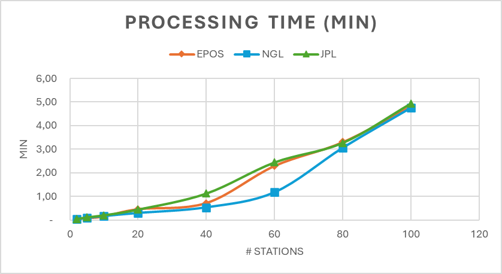

*Figure 31. Elapsed processing time for GVDA batch analysis of GNSS station time series from EPOS. NGL. and JPL. Tests were conducted on a desktop computer with an Intel Core i5-2400 CPU at 3.10 GHz and 16 GB of RAM. Batch sizes ranged from 2 to 100 stations.*

# Software requirements and dependencies

The GNSS Vector Direction Analysis (GVDA) plugin declares compatibility with QGIS Desktop versions 3.30–3.44. It uses PyQGIS for spatial operations and background tasks and the Qt bindings provided by QGIS (PyQt) for its graphical interface. Performance tests were conducted on Windows 10 (build 19045) using QGIS 3.44.4 (Solothurn). installed through OSGeo4W. with Python 3.12.12.

The two principal numerical dependencies are NumPy 1.26.4 and SciPy 1.13.0. NumPy is used in the optimised calculation of circular-median scores. while SciPy provides statistical and interpolation routines. GVDA also uses pandas 2.3.1 to handle GNSS station time series. Matplotlib 3.10.0 to display plots within the QGIS interface. and Pillow 11.1.0 for image handling.

All required Python libraries were available in the OSGeo4W environment used for testing; no additional Python packages had to be installed separately. The versions reported here describe the tested configuration. not minimum dependency requirements or verification of every QGIS release in the declared compatibility range.

# Supplementary documentation for the GVDA (GNSS Vector Direction Analysis) QGIS plugin

## Case study: Analysis of Eight GNSS Reference Stations

This document provides additional application examples of the GVDA (GNSS Vector Direction Analysis) QGIS plugin using eight GNSS continuously operating reference stations (CORS) selected from different tectonic settings.

The analyses complement the examples presented in the associated scientific article by illustrating the behaviour of circular statistical measures under different horizontal displacement patterns. The results obtained with GVDA are compared with the horizontal velocity directions reported by the EPOS GNSS Products Portal.

The document is intended to provide additional methodological information and graphical results without increasing the length of the main manuscript.

To verify the results presented in this article, the time series of eight CORS stations available from the EPOS GNSS Products Portal were analysed. The stations were selected on the basis of their geographic location relative to different tectonic plates. Table  2. Summary of the CORS stations selected for the analysis.presents the selected CORS stations, including their identifiers and agencies, as well as the tectonic plate on which each station is located (Figure 32).

*Table  2. Summary of the CORS stations selected for the analysis.*

| ID | Name | Country | Agency | Tectonic plate |
| --- | --- | --- | --- | --- |
| FLRS00PRT | Santa Cruz das Flores | Portugal | DGT | North America |
| HSCI00ITA | Scicli | Italy | INGV | Africa |
| KIPO00GRC | Ano Tiros | Greece | COMET | Aegean Sea |
| TRCG00REU | Citerne du Tremblet | France (Reunion Island) | IPGP | Somalia |
| REYK00ISL | Reykjavik | Iceland | BKG | North America |
| NICO00CYP | Nicosia-Athalassa | Cyprus | BKG | Anatolia |
| TDB000GLP | Terre de Bas - les Saintes | Guadeloupe | IPGP | Caribbean |
| MAD100ESP | Madrid | Spain | IGE | Eurasia |

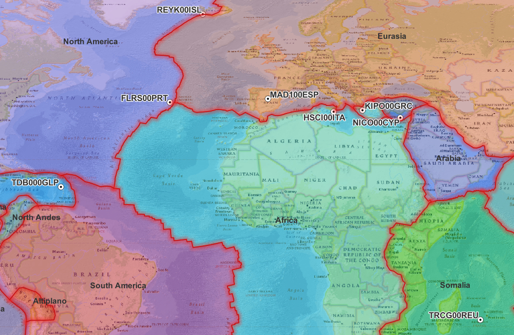

*Figure 32. Map generated in QGIS using the ESRI NatGeo_World_Map and USGS tectonic plate layers for the analysed CORS stations.Figure 32. Map generated in QGIS using the ESRI NatGeo_World_Map and USGS tectonic plate layers for the analysed CORS stations.*

The results obtained with the GVDA plugin are presented for each selected CORS station and compared with the horizontal velocity directions reported by the EPOS GNSS Products Portal. This comparison provides an assessment of the directional consistency between the GVDA results and the velocity estimates available from EPOS.

#### CORS Station: FLRS00PRT - Santa Cruz das Flores (Portugal)

Considering this Portuguese station, Figure 33 shows that the rose diagram exhibits a well-defined direction with an azimuth of approximately 332° (northwest), a circular variance of ±10°, and a moderate degree of concentration. This dispersion may be attributed to fluctuations in the eastwards component of displacement. Overall, the results are consistent with the horizontal velocity vector reported by the EPOS portal.

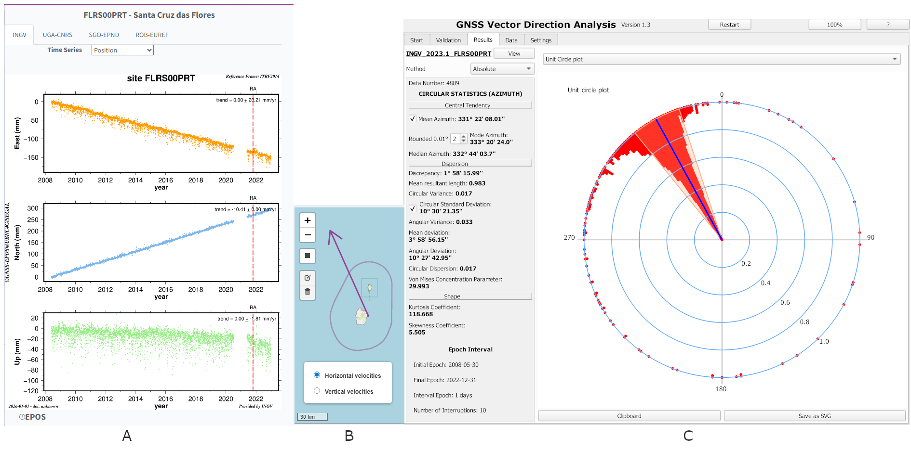

*Figure 33. Time series position from EPOS (A). Horizontal velocities from EPOS (B), and analysis result of GVDA (C) for the Santa Cruz das Flores CORS station.* 

#### CORS Station: HSCI00ITA - Scicli (Italy)

For the Italian station of Scicli, Figure 34 shows a horizontal displacement with a stable trend and a well-concentrated direction of movement (azimuth of approximately 47°), which is consistent with the EPOS portal velocity vector pointing approximately northeast, as well as low angular dispersion. This trend indicates continued tectonic stability. The dispersion is low, with some seasonal oscillations that generally point north, generating asymmetry in the graph. The length of the mean vector is high, indicating a consistent direction despite some dispersion; no evident secondary modes can be observed.

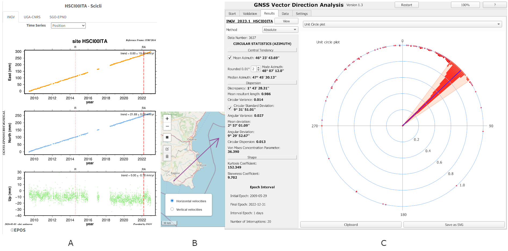

*Figure 34. Time series position from EPOS (A), horizontal velocities from EPOS (B), and analysis result of GVDA (C) for the Scicli CORS station.*

#### CORS Station: KIPO00GRC - KIPO (Greece)

The movement of the Greek station of Kipo (Figure 35) shows a horizontal displacement trending northeast, with low directional concentration and moderate to high angular dispersion, reflecting local tectonic deformation or temporary displacements that have altered the preferred direction. A high dispersion of points is observed, with greater variability towards the north, suggesting a possible postseismic effect in 2014. Central tendency statistics indicate a predominant northeast direction, with a median deviating from the mean and a multimodal trend. High angular dispersion suggests a lack of local rigidity in the displacement, which is evident in the low kurtosis values and the von Mises concentration parameter.

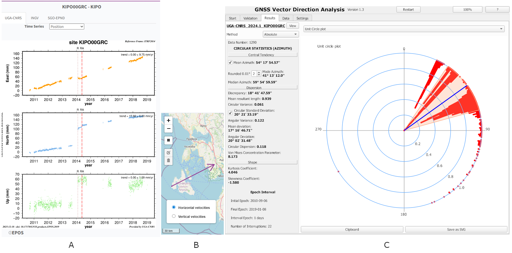

*Figure 35. Time series position from EPOS (A), horizontal velocities from EPOS (B), and analysis result of GVDA (C) for the KIPO CORS station.*

#### CORS Station: TRCG00REU - Citerne du Tremblet (Reunion)

The station located at Reunion Island (Figure 36) shows a horizontal shift with positive linear trends on the north and east components, suggesting a horizontal vector with an azimuth of approximately 48° but notable angular dispersion, revealing significant directional variability and a low mean vector length. The dispersion is moderate to high, with greater variability in the east than in the north. The close median and mode, although deviating from the mean, confirm a predominant north-eastwards direction, whereas the high dispersion reflects daily variability in orientation. The high angular dispersion, despite linear trends, suggests the presence of seasonal noise with events predominantly towards the north.

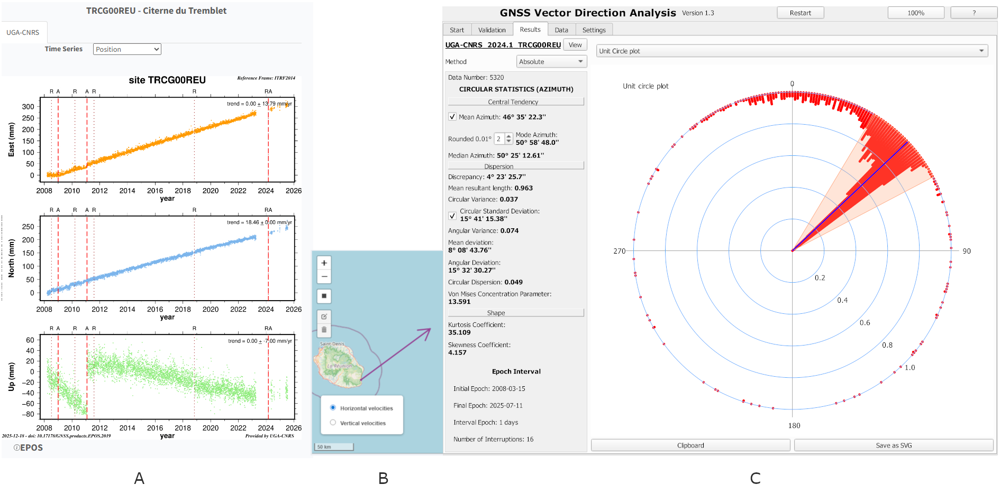

*Figure 36. Time series position from EPOS (A), horizontal velocities from EPOS (B), and analysis result of GVDA (C) for the Citerne du Tremblet CORS station.*

#### CORS Station: REYK00ISL – Reykjavik (Iceland)

The Icelandic station (Figure 37) reveals a stable horizontal displacement trending northwest, with a dominant tectonic signal over minimal noise, high directional concentration, and very low angular dispersion. The mean vector length is very high (L ≈ 0.998), the circular variance is small, and the von Mises concentration parameter is high, indicating very low angular dispersion: almost all the daily vectors align within a narrow fan around the mean azimuth. The polar diagram shows this concentration in a single sector, without secondary modes or bifurcations, indicating that the direction of horizontal motion did not change significantly during the analysed interval. The low circular variance confirms a consistent direction. This stable, highly concentrated azimuthal behaviour allows for this station to be used as a high-quality geodetic reference in studies of crustal deformation and in the integration and densification of regional reference frames.

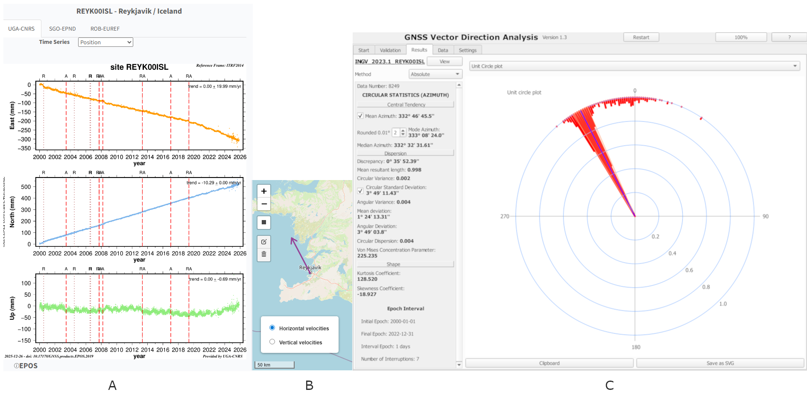

*Figure 37. Time series position from EPOS (A), horizontal velocities from EPOS (B), and analysis result of GVDA (C) for the Reykjavik CORS station.*

#### CORS Station: NICO00CYP – Nicosia-Athalassa (Cyprus)

This CORS station in Cyprus (Figure 38) shows stable northeast-trending horizontal displacement with high directional concentration and very low angular dispersion, indicating consistent tectonic movement, which is validated by the high length of the mean vector circular statistic. The unit circle diagram concentrates the vectors in a narrow sector (approximately 51°), with low angular dispersion and directional consistency between the mean, median, and mode. The high circular concentration confirms the station’s reliability for EUREF networks in Mediterranean deformation studies.

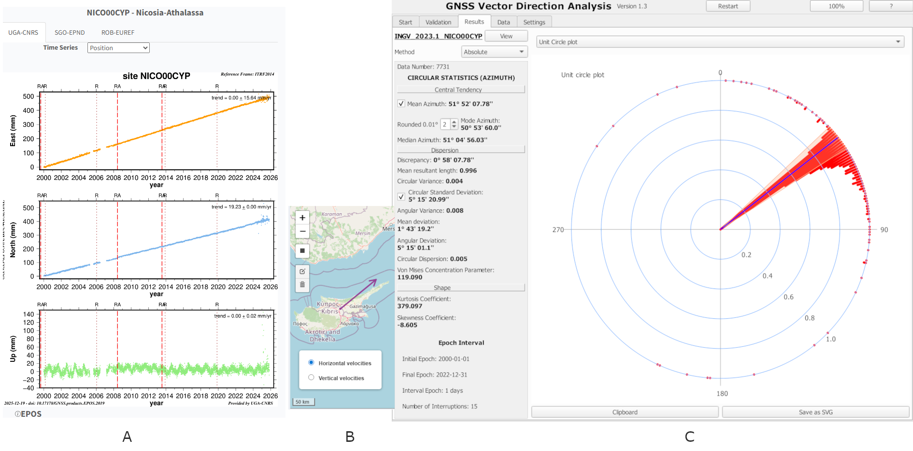

*Figure 38. Time series position from EPOS (A), horizontal velocities from EPOS (B), and analysis result of GVDA (C) for the Nicosia-Athalassa CORS station.*

#### CORS Station: TDB000GLP – Terre-de-Bas - Les Saintes (Guadeloupe)

The horizontal shift trend of the Caribbean CORS station (Figure 39) is northeast, with good directional concentration but moderate angular dispersion. Moderate daily dispersion is observed, without notable discontinuities and with low noise levels. The mean vector (approximately 34°) confirms the predominant direction, although the daily variability is significant, resulting in the median (approximately 36°) and mode (approximately 37°) differing from the mean. The Terre-de-Bas station may be suitable for WI/EUREF networks, with caution regarding directional stability.

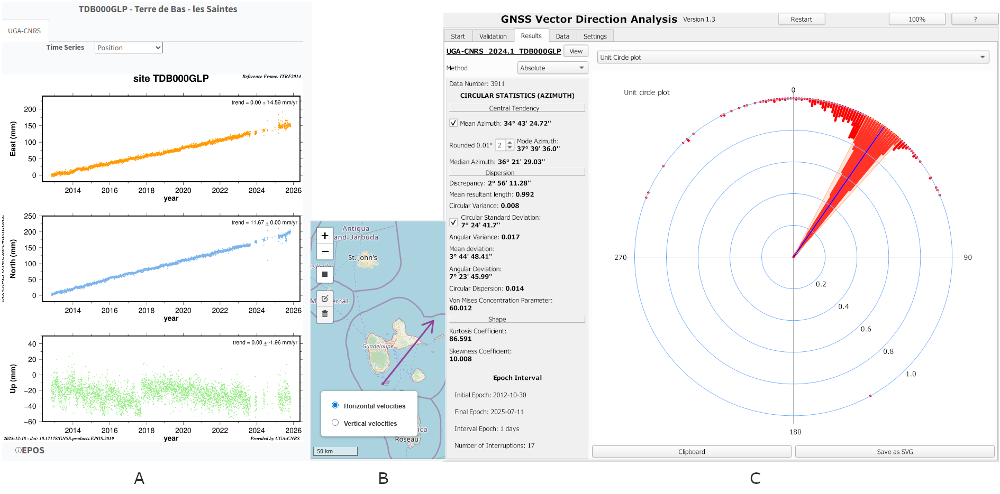

*Figure 39. Time series position from EPOS (A), horizontal velocities from EPOS (B), and analysis result of GVDA (C) for Terre-de-Bas-Les Saintes CORS station.*

#### CORS Station: MAD100ESP - Madrid (Spain)

Figure 9 for the Madrid CORS station reveals a stable horizontal shift towards the northeast, with robust linear trends where the mean, median, and mode coincide. The directional concentration is very high, reflecting intraplate stability in the Iberian Peninsula. The length of the mean vector confirms directional consistency. The high circular concentration supports the fiducial quality of this station for EUREF applications.

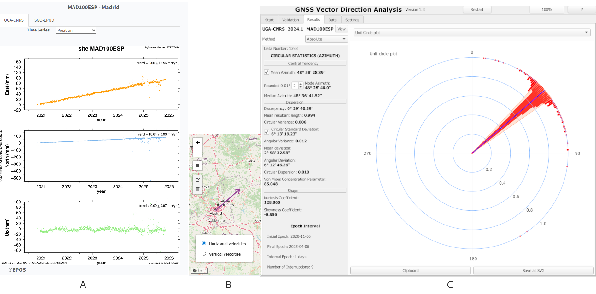

*Figure 40. Time series position from EPOS (A), horizontal velocities from EPOS (B), and analysis result of GVDA (C) for the Madrid CORS station.*

*Table  3. Presents a summary of the statistical results obtained with the GVDA plugin for the selected CORS stations.*

|  | FLRS00PRT | HSCI00ITA | KIPO00GRC | TRCG00REU | REYK00ISL | NICO00CYP | TDB000GLP | MAD100ESP |
| --- | --- | --- | --- | --- | --- | --- | --- | --- |
| Central Tendency |  |  |  |  |  |  |  |  |
| Mean azimuth | 331°22’08” | 46°23’44” | 54°17’55” | 46°35’22” | 332°46’45” | 51°52’08” | 34°43’25” | 48°58’28” |
| Mode azimuth | 333°20’24” | 48°07’12” | 41°13’12” | 50°58’48” | 333°08’24” | 50°53’60” | 37°39’36” | 48°28’48” |
| Median azimuth | 332°44’07” | 47°45’30” | 59°55’00” | 50°25’13” | 332°32’31” | 51°04’57” | 36°21’29” | 48°36’41” |
| Dispersion |  |  |  |  |  |  |  |  |
| Discrepancy | 1°58’16” | 1°43’28” | 18°41’48” | 4°23’26” | 0°35’52” | 0°58’08” | 2°56’11” | 0°29’40.39” |
| Length of mean vector | 0.983 | 0.986 | 0.939 | 0.963 | 0.998 | 0.996 | 0.992 | 0.994 |
| Circular variance | 0.017 | 0.014 | 0.061 | 0.037 | 0.002 | 0.004 | 0.008 | 0.006 |
| Circular Standard Deviation | 10°30’21” | 9°31’51” | 20°21’33” | 15°41’15” | 3°49’11” | 5°15’21” | 7°24’42” | 6°13’19.23” |
| Angular Variance | 0.033 | 0.027 | 0.122 | 0.074 | 0.004 | 0.008 | 0.017 | 0.012 |
| Mean Angular Deviation | 10°27’43” | 9°29’53” | 20°02’31” | 15°32’30” | 3°49’04” | 5°15’01” | 7°23’46” | 6°12’46.26” |
| Angular Standard Deviation | 3°58’56” | 2°57’01” | 17°16’47” | 8°08’44” | 1°24’13” | 1°43’19” | 3°44’48” | 2°58’32.58” |
| Circular Dispersion | 0.017 | 0.013 | 0.118 | 0.049 | 0.004 | 0.005 | 0.014 | 0.010 |
| von Mises Concentration Parameter | 29.993 | 36.390 | 8.173 | 13.591 | 225.235 | 119.090 | 60.012 | 85.048 |
| Shape |  |  |  |  |  |  |  |  |
| Kurtosis Coefficient | 118.668 | 152.349 | 4.046 | 35.109 | 128.520 | 379.097 | 86.591 | 128.860 |
| Skewness | 5.505 | 9.702 | -1.580 | 4.157 | -18.927 | -8.605 | 10.008 | -8.856 |

In the evaluated dataset, as the discrepancies between the central tendency estimators increase, the concentration values decrease noticeably, leading to higher magnitudes in the dispersion estimators. In these cases, lower values of the mean vector length and higher dispersion metrics are observed, which can cause the mean or median to be potentially biased by this behaviour. This may indicate clustering in alternative directions or bias due to temporary displacement records.

Although this behaviour may appear evident from a statistical perspective, it can be further examined by considering the remaining statistics as a whole. Under linear displacement behaviour, the expected trend is that the measures of central tendency coincide, and the discrepancies between them remain minimal. Therefore, differences between the mean, median, and mode indicate a degree of asymmetry in the displacement trend, which can be further assessed using dispersion and shape statistics.

The discrepancies among central tendency estimators and the associated dispersion statistics illustrate how observations cluster around the central azimuth. CORS stations with mean vector length values close to 1 (e.g., REYK00ISL and NICO00CYP) exhibit high directional concentrations, whereas lower values indicate greater dispersion (e.g., KIPO00GRC and TRCG00REU).

Circular variance and circular standard deviation quantify angular variability. Stations such as KIPO00GRC and TRCG00REU, which exhibit high variance, show greater rotational dispersion, further amplified by the recurrent presence of displacements clustering towards orientations different from the mean direction. This behaviour should not be disregarded, since when temporary displacements are present (Figure 41), these statistics may highlight secondary resilient patterns that recurrently generate directional deviations. Alternatively, they may indicate gradual changes in direction, suggesting nonlinear displacement behaviour throughout the time series.

*Figure 41. Temporary displacements in the time series of the KIPO00GRC CORS station.*

The REYK00ISL, NICO00CYP, and MAD100ESP stations, which exhibit high concentrations and low dispersion, suggest homogeneous behaviour in the displacement direction. In contrast, stations such as KIPO00GRC and TRCG00REU show greater angular dispersion and variance, indicating greater directional variability that may be associated with more complex displacement processes.

### Batch Analysis

Batch analysis allows the data from multiple stations to be grouped into a single compressed (ZIP) file and processed jointly. This file type can be uploaded through the “Search Time Series” tab of the plugin (Figure 42). The ZIP file may contain a large number of stations, as the tool does not impose a fixed limit; its practical capacity depends on the available computing resources. The plugin has been tested with batches of up to 110 stations and performed satisfactorily (see README). In this example, the eight stations previously analysed individually were processed together as a batch.

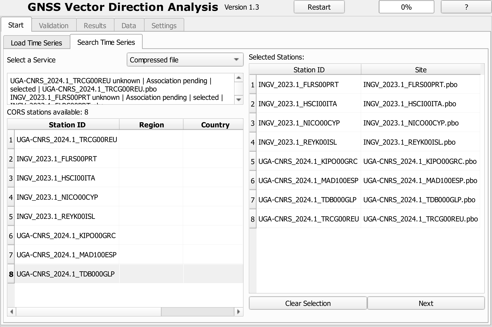

*Figure 42. Interface for loading ZIP files.*

In the Validation menu, the user specifies the fields containing the epoch, the difference in the North component, and the difference in the East component. In addition, the user must define whether the dataset is associated with geographic coordinates contained in the data themselves, or whether it is referenced to the position of the station (Figure 43).

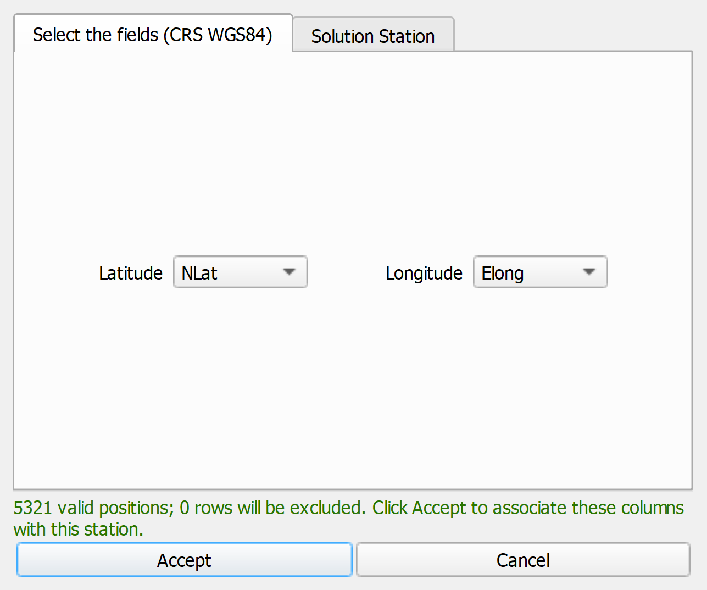

*Figure 43.Selection of the fields used to define the geographic position of the station.*

To prevent inconsistencies in the association between data and station position, the geographic coordinates, or the fields that contain them, must be specified for each station individually.

If the geographic position of a station is not defined at this stage, the option to perform the association is enabled at a later step. In the batch process, all statistics can still be computed for every station; however, stations without a defined geographic position cannot be displayed on the map (Figure 44).

*Figure 44.Results interface for batch analysis.*

When the “View” button is pressed, the plugin plots on the map the direction vectors, representing the mean azimuth and the circular standard deviation, of every station that has valid geographic coordinates (Figure 45).

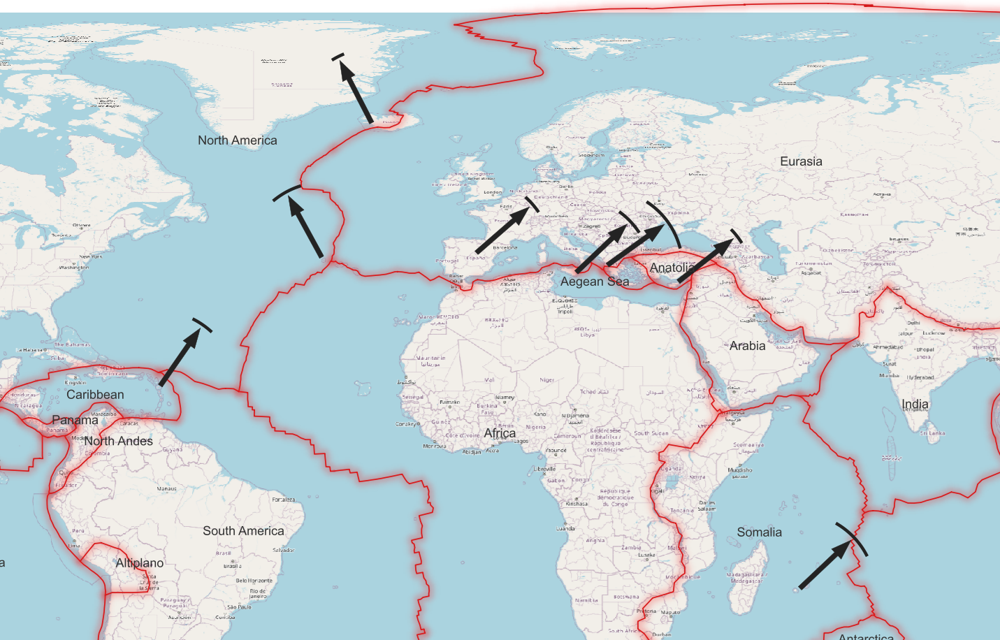

*Figure 45. Spatial representation of the analysed GNSS stations in QGIS. Arrow directions represent the mean azimuth , and the arcs represent the circular standard deviation. Basemap: OpenStreetMap; tectonic plate boundaries: USGS.*

## References:

Batschelet, E. (1981). Circular Statistics in Biology. Academic Press.

Cihangir Akşit, E., 2010. Evaluation of Land Maps, Aeronautical Charts and Digital Topographic Data https://www.intertekinform.com/en-us/standards/stanag-2215-2010-736757_saig_nato_nato_1789654/

Fisher, N. I. 1993. Statistical Analysis of Circular Data. Cambridge University Press. https://doi.org/10.1017/CBO9780511564345

Mahan, R. P. (1991). Circular Statistical Methods: Applications in Spatial and Temporal Performance Analysis. United States Army Research Institute for the Behavioral and Social Sciences, Special Report 16.

Mardia, K., & Jupp, P. 2000. Directional Statistics. https://doi.org/10.1002/9780470316979

Mardia, K. V., 1975. Statistics of Directional Data. Journal of the Royal Statistical Society. Series B (Methodological), 37(3), 349-393. http://www.jstor.org/stable/2984782

Ratanaruamkam, S. (2006). New Estimators of a Circular Median. Western Michigan University.

Zar, J. H. (1996). Biostatistical Analysis (3rd ed.). Prentice Hall.

## License

Copyright (C) 2026, Anonymous authors. This program is free software: you can redistribute it and/or modify it under the terms of the GNU General Public License as published by the Free Software Foundation, either version 3 of the License, or any later version. This program is distributed in the hope that it will be useful, but WITHOUT ANY WARRANTY; without even the implied warranty of MERCHANTABILITY or FITNESS FOR A PARTICULAR PURPOSE. See the GNU General Public License for more details. You should have received a copy of the GNU General Public License along with this program. If not, see https://www.gnu.org/licenses/.
